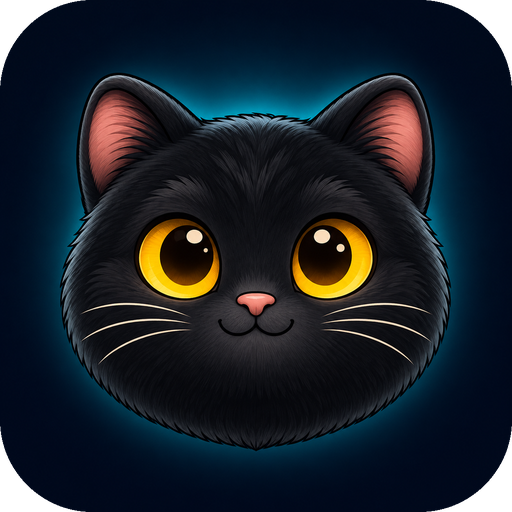
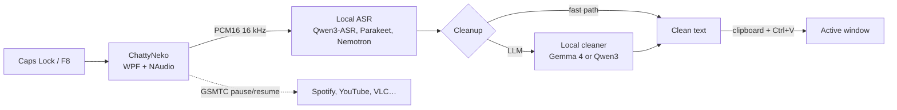

<p align="center">
  
</p>

<h1 align="center">ChattyNeko</h1>

<p align="center">
  <strong>Local push-to-talk dictation for Windows.</strong><br/>
  One process, selectable local models, no cloud and no subscription.
</p>
<p align="center">
  <a href="https://github.com/hal9ooo/GangioKeet/releases/latest"></a>
</p>

<p align="center">
  <a href="LICENSE"></a>
  
  
  <a href="https://github.com/hal9ooo/GangioKeet/actions/workflows/security.yml"></a>
</p>

<p align="center">
  
</p>
<p align="center"><sub>ChattyNeko: local dictation, a black cat, and a lightning flash. No cloud, no account.</sub></p>

> **TL;DR** — Hold **Caps Lock**, talk, release. The text appears in the active
> window. Media playback pauses while you dictate and resumes when you release.

> **Status:** works on my machine. There is exactly one known user. If you are
> not me, you are an early adopter, a mistake, or a very bored person.

> **Splash payoff:** *A one-user project putting local GPUs to work.*

ChattyNeko is a personal Windows dictation client. Speech-to-text and the
optional LLM cleanup run in the same process: WASAPI microphone → local ASR →
local cleaner → clipboard-preserving paste. No audio or transcript leaves the
machine; the only network access is model and runtime provisioning from Hugging
Face and GitHub.

## What it does

- **Push-to-talk, Wispr Flow style**: hold **Caps Lock** (or F8), talk, release.
  Double-tap for hands-free, **Esc** to abort.
- **Fully local**: pick any ASR — Parakeet, Qwen3-ASR or Nemotron 3.5
  Transcribe — and pair it with no refinement, the deterministic **Pulizia
  leggera**, or a local LLM. The choice is global and applies hot, without
  restarting.
- **Fast refinement**: short, clean phrases skip the cleaner entirely (fast
  path); **Pulizia leggera** cleans fillers and repetitions deterministically,
  with no model to load and no added latency.
- **Media pause**: when dictation starts, playing media sessions are paused via
  Windows GSMTC; when the key is released, only the sessions paused by
  ChattyNeko are resumed. Always on, no setting.
- **Context-aware**: `code`, `terminal`, `chat`, `email`, and `document`
  profiles chosen from the active app and window title, with browser rules.
- **Quality of life**: animated floating pill, tray menu with a launch-at-startup
  toggle, microphone picker, always copyable last dictation, and
  clipboard-preserving paste.
- **Recovery**: if the target window disappears or loses focus during paste, the
  text is kept in RAM and can be copied from the tray; a failed dictation can
  also be retried from its buffered audio. The last successful text stays
  copyable for the session.
- **Privacy by default**: content-free logs, no on-disk history; benchmark
  recording is opt-in and stored under `%LOCALAPPDATA%\ChattyNeko\recordings`.

## What it doesn't do

- No cloud, no account, no telemetry, no HTTP server.
- No team plan, no pricing page, no "Contact sales".
- No deployment outside Windows: the repository is Windows-only.
- No automatic Enter: the text is pasted, not sent.
- No promise of an SLA. There is one user and a cat.

## Architecture



The flow, in short:

1. The client captures WASAPI audio and converts it to PCM16 mono 16 kHz.
2. The local ASR model transcribes.
3. If the phrase is short and has no self-correction triggers or glossary
   overrides, the cleaner is skipped (**fast path**). Otherwise the local LLM
   fixes punctuation, self-corrections, and glossary terms.
4. The text is pasted into the active window with clipboard preservation and
   **without pressing Enter**.

## Requirements

| Part | What you need |
|---|---|
| **Runtime** | Windows 11 (Windows 10 is not certified) |
| **Build** | .NET 10 SDK |
| **Models** | Provisioned on demand by the client; the installer does not ship GGUF files |
| **Evaluation (optional)** | Python 3.12 and `scripts/requirements.txt` |

Python is only needed for the offline evaluation scripts. The runtime has no
Python dependency.

## Quick start

```powershell
git clone https://github.com/hal9ooo/GangioKeet.git
cd GangioKeet
New-Item -ItemType Directory -Force "$env:APPDATA\ChattyNeko" | Out-Null
Copy-Item client-windows\client_config.example.yaml "$env:APPDATA\ChattyNeko\client_config.yaml"
dotnet build client-windows\GangioKeet.Client.sln
dotnet run --project client-windows\src\GangioKeet.Client
```

The client starts in the tray with no main window. On first run it reads
`inference.model_selection_path` (default `models/selected.json`) and downloads
or verifies the missing model artifacts. Wait for the tray state to become
ready, then hold **Caps Lock** and speak.

The tray menu has the microphone picker, the last-dictation actions, the
settings window, **Avvia con Windows**, and the exit command. **Copia ultimo
testo** is available after any dictation with text, including a successful
paste; **Riprova** and **Scarta recupero** are enabled only when there is a
failed dictation to recover. **Avvia con Windows** writes or removes a per-user
value under `HKCU\Software\Microsoft\Windows\CurrentVersion\Run\ChattyNeko`; it
is off by default and the checkbox reflects the current registry state. The
settings window selects the ASR and the optional refinement, toggles benchmark
recording, and sets the models folder. Model and refinement changes apply
immediately; a new models folder takes effect after a restart.

## Configuration

The default path is `%APPDATA%\ChattyNeko\client_config.yaml`.

| Section | Key fields |
|---|---|
| `inference` | `model_selection_path`, `models_root`, `cleanup_policy_path`, `backend` (`vulkan` or `cpu`) |
| `recording` | `enabled`, `directory` |
| `hotkey` | `mode` (`push_to_talk`/`toggle`), `key`, `abort_key`, double-tap timings |
| `audio` | `input_device`, sample rate 16000, mono, 100 ms chunks |
| `paste` | `default_combo`, `terminal_combo`, `terminal_apps`, clipboard delay |
| `ui` | `show_floating_pill`, `pill_position`, `sound_feedback` |
| `context_profiles` | executable lists for code/terminal/chat/email/document |
| `browser_profiles` | browser list and page-title rules |
| `recovery` | `retention_seconds` |

The schema is strict: unknown keys are rejected. Legacy keys (`server`,
`endpoints`, `inference.mode`) are tolerated **in memory** and ignored, so an
existing `client_config.yaml` keeps loading as a local configuration. The app
does not rewrite those keys; they simply have no effect.

## Media pause

While dictating, ChattyNeko asks Windows GSMTC to pause every media session that
is currently `Playing`. On key release it resumes only the sessions it paused,
and only if they are still `Paused`. If you resume a player manually during
dictation, it is left alone. If a player refuses the pause, it is not registered
and is never played on release.

The pause has a 750 ms budget: an unresponsive app cannot block the microphone.
If you release the key while the pause is still in flight, the capture is
cancelled and the media is resumed immediately.

## The pill

The floating pill is a 220×40 DIP WPF window with a rounded GDI region. It is
opaque, never takes focus, stays out of the taskbar and Alt+Tab, and draws
through `CompositionTarget.Rendering` gated to roughly 60 Hz, so the animation
runs on the GPU instead of the dispatcher.

<p align="center">
  
</p>

- **Status dot** — green while recording, yellow while arming or processing,
  orange for a warning, red for an error, grey for an empty result. It grows
  with the microphone level.
- **Wave** — while recording, the status text is replaced by 23 square off-white
  bars. Their heights come from a three-octave scrolling noise field, so the
  ribbon slides sideways and keeps changing shape instead of oscillating in
  place, in the spirit of the Wispr Flow pill. Bar width and pitch are uniform
  on the physical pixel grid, including at fractional display scaling.
- **Microphone response** — the smoothed peak drives the envelope: about 16%
  height at silence and full height on voice, with a 12 ms attack and a 120 ms
  release. The wave is an indicator, never a capture gate: it cannot delay or
  stop dictation.
- **Autogain** — the live peak is normalized against the **90th percentile** of
  the last recording's non-silent chunks, so a quiet microphone still fills the
  pill while a cough cannot skew the reference. The value is persisted in
  `%LOCALAPPDATA%\ChattyNeko\mic-calibration.json` (a single number, no audio);
  delete the file to reset. Only the visualization is scaled: the PCM sent to
  the ASR is never altered.
- **Sounds** — a short synthesized click marks the end of a dictation instead of
  the old beep; the start and error cues are unchanged.

## Model combinations

The active choice lives in `%APPDATA%\ChattyNeko\selection.json`; the
installer ships a seed in `catalog\selection.json` and the app copies it on
first run:

```json
{"schema_version":2,"stt_id":"parakeet_v3","cleaner_id":"gemma4_e2b","refinement_enabled":true}
```

The settings window has an **ASR** selector, a **Refinement** on/off checkbox,
and a **cleaner** selector. Any ASR can be paired with any cleaner, or
refinement can be off. Changes apply hot: the ASR and cleaner are swapped in
place, and a dictation already being processed finishes on the old engines.

### Recognition

| ASR | Notes |
|---|---|
| **Parakeet v3** | Fastest option; best fidelity/latency balance in the real-voice tests. |
| **Qwen3-ASR** | Strong punctuation and formatting; heavier and slower than Parakeet. |
| **Nemotron 3.5 Transcribe 30B A4B** | Experimental. About 21 GB of GGUF files plus a ~22 MB NeMo-Speech Vulkan runtime; slower to start and wants a Vulkan-capable GPU. |

### Refinement

| Cleaner | Notes |
|---|---|
| **Nessuno** | Raw ASR output, fastest path. |
| **Pulizia leggera** | Deterministic, no model and no download: it removes only filled pauses and immediate repetitions (for example `Mi mi mandi un una lista` becomes `Mi mandi una lista`). Zero added latency. |
| **Gemma 4 E2B** | Local LLM: punctuation, self-corrections, and glossary terms. |
| **Qwen3 1.7B / 4B** | Local LLM alternatives at two sizes. |

**Pulizia leggera** is the fast refinement to use with Nemotron: its raw output
keeps the speaker's hesitations, and the deterministic pass cleans them without
loading another model.

### Provisioning

Nothing is bundled: the installer ships the client, the native runtimes, the
cleanup policy, and the selection JSON, never the GGUF weights. Picking a model
downloads it on demand from Hugging Face (and, for Nemotron, the runtime from
GitHub) over HTTPS with SHA-256 verification. Downloads keep the partial file
and resume with HTTP Range after a crash or a dropped connection, including
Hugging Face's Xet-backed files.

**Nemotron 3.5 Transcribe 30B A4B** is the experimental third ASR. The first
selection asks for confirmation in Settings and then shows a download
percentage. While the model is warming up, pressing the dictation hotkey starts
capturing immediately and buffers the audio until the model is ready, so Caps
Lock never waits for the 21 GB model to load.

`catalog\candidates.json` is the single source for artifact paths and hashes,
pinned by `catalog\integrity.json`. The `catalog\` folder lives next to the
executable, outside `models\`, which may be a junction to another volume.
Legacy `selected.json`/`selected-parakeet-qwen.json` are migrated on first run.
On the real-voice tests, **Parakeet + Nessuno** is the best fidelity/latency
choice; **Parakeet + Gemma** preserves questions and normalizes technical terms.
If a combination cannot load, the client stays in the tray in a NotReady state;
the settings window offers **Riprova modelli** to rebuild it.

## Privacy and security

- **No audio or text over the network**: the runtime opens no HTTP listener and
  never sends audio, transcripts, window titles, or telemetry to a service.
- **Model and runtime provisioning is the only network access**: on first run or
  when you change model combination, the client downloads missing model files
  from `huggingface.co` and, only for Nemotron, the NeMo-Speech runtime from
  GitHub over HTTPS. Those hosts see your IP address and the requested
  repository/asset; they never receive audio or text.
- **No history by default**: audio and transcripts live in RAM. If
  `recording.enabled` is on, completed local dictations are written under
  `%LOCALAPPDATA%\ChattyNeko\recordings` (or the configured `recording.directory`)
  with empty human references.
- **Logs are content-free**: daily files in `%LOCALAPPDATA%\ChattyNeko\logs\`
  contain codes and technical details, never audio, transcripts, window titles,
  or API keys.
- **Microphone calibration is a single number**: the pill's autogain stores only
  the normalized peak reference in
  `%LOCALAPPDATA%\ChattyNeko\mic-calibration.json`. It contains no audio, no
  device name, and no timestamp.
- **Clipboard**: the client reads text and DIB from the clipboard only to back
  them up, and restores them only if nobody copied something else in the
  meantime. It never inspects, logs, or transmits clipboard contents, and it
  never presses Ctrl+C.
- **Clipboard history**: dictated text is placed on the Windows clipboard, so
  Windows Clipboard History or cloud clipboard may retain it if those features
  are enabled. Disable them if you dictate sensitive material.
- **No API keys**: there is no token handling and no credential file.

`recording.store_context` is still accepted for backward compatibility, but it
has no effect: selected text is never stored.

See [SECURITY.md](SECURITY.md) for the reporting policy.

## Performance and model selection

The current measured pair and the corpus protocol are documented in
[docs/benchmarks/local-monolith/selection.md](docs/benchmarks/local-monolith/selection.md).
The evaluation scripts run the local native runtime on Windows; they do not use
a Python server.

## Development and tests

```powershell
dotnet build client-windows\GangioKeet.Client.sln
dotnet test client-windows\GangioKeet.Client.sln
```

The client tests cover the controller lifecycle, media pause/resume ordering,
configuration compatibility, hotkeys, audio conversion, paste, recording,
recovery, hot model-combination switching, the pill waveform, and the
microphone autogain.

Offline evaluation:

```powershell
python -m venv .venv
.venv\Scripts\python -m pip install -r scripts\requirements.txt
.venv\Scripts\python -m pytest tests\test_stt_eval_native_report.py tests\test_stt_eval_punctuation.py tests\test_stt_eval_ingest.py tests\test_stt_eval_analyze.py tests\test_stt_eval_review.py tests\test_namespace_llama_runtime.py -q
```

`scripts/eval_local_monolith.ps1` expects a built `GangioKeet.Eval` runner and
the manifests under `tests/fixtures/stt_eval/`; it invokes the same scoring
chain (`stt_eval_native_report.py` → `stt_eval_metrics.py` /
`stt_eval_punctuation.py`).

## Packaging

```powershell
powershell -File scripts/package_windows.ps1 -Configuration Release
powershell -File scripts/verify_windows_package.ps1 -Payload artifacts/package -Selection client-windows/models/selected.json
```

The package contains the client, the native runtimes, the cleanup policy, and
the selection JSON. GGUF model files are provisioned on demand and are not part
of the installer payload.

## Limits

- Windows only.
- `vulkan` is the recommended backend; `cpu` is supported but slower.
- Media pause depends on what each app exposes through GSMTC. Apps that do not
  implement pause are left untouched.
- This is a personal project, not a product. If it breaks, I look at it.

## Credits

The name is **ChattyNeko**: *chatty* for the dictation, *neko* for the black cat
that is the brand. The cat on the icon has golden eyes and sits in front of a
lightning flash, because a black cat lit by a storm was the only logical choice
at 1 a.m.

## License

MIT. See [LICENSE](LICENSE) and [THIRD_PARTY_NOTICES.md](THIRD_PARTY_NOTICES.md).
