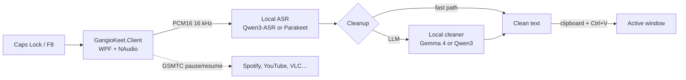

<p align="center">
  
</p>

<h1 align="center">GangioKeet</h1>

<p align="center">
  <strong>Local push-to-talk dictation for Windows.</strong><br/>
  One process, selectable local models, no cloud and no subscription.
</p>

<p align="center">
  <a href="LICENSE"></a>
  
  
  <a href="https://github.com/hal9ooo/GangioKeet/actions/workflows/security.yml"></a>
</p>

> **TL;DR** — Hold **Caps Lock**, talk, release. The text appears in the active
> window. Media playback pauses while you dictate and resumes when you release.

> **Status:** works on my machine. There is exactly one known user. If you are
> not me, you are an early adopter, a mistake, or a very bored person.

> **Splash payoff:** *A one-user project putting local GPUs to work.*

GangioKeet is a personal Windows dictation client. Speech-to-text and the
optional LLM cleanup run in the same process: WASAPI microphone → local ASR →
local cleaner → clipboard-preserving paste. No audio or transcript leaves the
machine; the only network access is model provisioning from Hugging Face.

## What it does

- **Push-to-talk, Wispr Flow style**: hold **Caps Lock** (or F8), talk, release.
  Double-tap for hands-free, **Esc** to abort.
- **Fully local**: choose any ASR + refinement combination on the Windows
  machine, or turn refinement off entirely. The choice is global and applies
  hot, without restarting.
- **Media pause**: when dictation starts, playing media sessions are paused via
  Windows GSMTC; when the key is released, only the sessions paused by
  GangioKeet are resumed. Always on, no setting.
- **Context-aware**: `code`, `terminal`, `chat`, `email`, and `document`
  profiles chosen from the active app and window title, with browser rules.
- **Quality of life**: floating pill, tray menu, microphone picker, always
  copyable last dictation, and clipboard-preserving paste.
- **Recovery**: if the target window disappears or loses focus during paste, the
  text is kept in RAM and can be copied from the tray; a failed dictation can
  also be retried from its buffered audio. The last successful text stays
  copyable for the session.
- **Privacy by default**: content-free logs, no on-disk history; benchmark
  recording is opt-in and stored under `%LOCALAPPDATA%\GangioKeet\recordings`.

## What it doesn't do

- No cloud, no account, no telemetry, no HTTP server.
- No team plan, no pricing page, no "Contact sales".
- No deployment outside Windows: the repository is Windows-only.
- No automatic Enter: the text is pasted, not sent.
- No promise of an SLA. There is one user and a bird.

## Architecture



The flow, in short:

1. The client captures WASAPI audio and converts it to PCM16 mono 16 kHz.
2. The local ASR model transcribes.
3. If the phrase is short and has no self-correction triggers or glossary
   overrides, the cleaner is skipped (**fast path**). Otherwise the local LLM
   fixes punctuation, self-corrections, and glossary terms.
4. The text is pasted into the active window with clipboard preservation and
   **without pressing Enter**.

## Requirements

| Part | What you need |
|---|---|
| **Runtime** | Windows 11 (Windows 10 is not certified) |
| **Build** | .NET 10 SDK |
| **Models** | Provisioned on demand by the client; the installer does not ship GGUF files |
| **Evaluation (optional)** | Python 3.12 and `scripts/requirements.txt` |

Python is only needed for the offline evaluation scripts. The runtime has no
Python dependency.

## Quick start

```powershell
git clone https://github.com/hal9ooo/GangioKeet.git
cd GangioKeet
New-Item -ItemType Directory -Force "$env:APPDATA\GangioKeet" | Out-Null
Copy-Item client-windows\client_config.example.yaml "$env:APPDATA\GangioKeet\client_config.yaml"
dotnet build client-windows\GangioKeet.Client.sln
dotnet run --project client-windows\src\GangioKeet.Client
```

The client starts in the tray with no main window. On first run it reads
`inference.model_selection_path` (default `models/selected.json`) and downloads
or verifies the missing model artifacts. Wait for the tray state to become
ready, then hold **Caps Lock** and speak.

The tray menu has the microphone picker, the last-dictation actions, the
settings window, and the exit command. **Copia ultimo testo** is available after
any dictation with text, including a successful paste; **Riprova** and
**Scarta recupero** are enabled only when there is a failed dictation to
recover. The settings window selects the ASR and the optional refinement and
toggles benchmark recording; all changes apply immediately.

## Configuration

The default path is `%APPDATA%\GangioKeet\client_config.yaml`.

| Section | Key fields |
|---|---|
| `inference` | `model_selection_path`, `cleanup_policy_path`, `backend` (`vulkan` or `cpu`) |
| `recording` | `enabled`, `directory` |
| `hotkey` | `mode` (`push_to_talk`/`toggle`), `key`, `abort_key`, double-tap timings |
| `audio` | `input_device`, sample rate 16000, mono, 100 ms chunks |
| `paste` | `default_combo`, `terminal_combo`, `terminal_apps`, clipboard delay |
| `ui` | `show_floating_pill`, `pill_position`, `sound_feedback` |
| `context_profiles` | executable lists for code/terminal/chat/email/document |
| `browser_profiles` | browser list and page-title rules |
| `recovery` | `retention_seconds` |

The schema is strict: unknown keys are rejected. Legacy keys (`server`,
`endpoints`, `inference.mode`) are tolerated **in memory** and ignored, so an
existing `client_config.yaml` keeps loading as a local configuration. The app
does not rewrite those keys; they simply have no effect.

## Media pause

While dictating, GangioKeet asks Windows GSMTC to pause every media session that
is currently `Playing`. On key release it resumes only the sessions it paused,
and only if they are still `Paused`. If you resume a player manually during
dictation, it is left alone. If a player refuses the pause, it is not registered
and is never played on release.

The pause has a 750 ms budget: an unresponsive app cannot block the microphone.
If you release the key while the pause is still in flight, the capture is
cancelled and the media is resumed immediately.

## Model combinations

The active choice lives in `%APPDATA%\GangioKeet\selection.json`; the
installer ships a seed in `models/selection.json` and the app copies it on
first run:

```json
{"schema_version":2,"stt_id":"parakeet_v3","cleaner_id":"gemma4_e2b","refinement_enabled":true}
```

The settings window has an **ASR** selector, a **Refinement** on/off checkbox,
and a **cleaner** selector. Any ASR can be paired with any cleaner, or
refinement can be off. Changes apply hot: the ASR and cleaner are swapped in
place, and a dictation already being processed finishes on the old engines.

**Nemotron 3.5 Transcribe 30B A4B** is an experimental third ASR. It needs about
21 GB of GGUF files plus a ~22 MB NeMo-Speech Vulkan runtime, downloaded on
demand from Hugging Face and GitHub and never bundled in the installer. The
first selection asks for confirmation in Settings and then shows a percentage;
it is slower to start and wants a Vulkan-capable GPU.

`models/candidates.json` is the single source for artifact paths and hashes,
pinned by `models/integrity.json`. Legacy
`selected.json`/`selected-parakeet-qwen.json` are migrated on first run.
On the real-voice tests, **Parakeet + Nessuno** is the best fidelity/latency
choice; **Parakeet + Gemma** preserves questions and normalizes technical terms.
If a combination cannot load, the client stays in the tray in a NotReady state;
the settings window offers **Riprova modelli** to rebuild it.

## Privacy and security

- **No audio or text over the network**: the runtime opens no HTTP listener and
  never sends audio, transcripts, window titles, or telemetry to a service.
- **Model and runtime provisioning is the only network access**: on first run or
  when you change model combination, the client downloads missing model files
  from `huggingface.co` and, only for Nemotron, the NeMo-Speech runtime from
  GitHub over HTTPS. Those hosts see your IP address and the requested
  repository/asset; they never receive audio or text.
- **No history by default**: audio and transcripts live in RAM. If
  `recording.enabled` is on, completed local dictations are written under
  `%LOCALAPPDATA%\GangioKeet\recordings` (or the configured `recording.directory`)
  with empty human references.
- **Logs are content-free**: daily files in `%LOCALAPPDATA%\GangioKeet\logs\`
  contain codes and technical details, never audio, transcripts, window titles,
  or API keys.
- **Clipboard**: the client reads text and DIB from the clipboard only to back
  them up, and restores them only if nobody copied something else in the
  meantime. It never inspects, logs, or transmits clipboard contents, and it
  never presses Ctrl+C.
- **Clipboard history**: dictated text is placed on the Windows clipboard, so
  Windows Clipboard History or cloud clipboard may retain it if those features
  are enabled. Disable them if you dictate sensitive material.
- **No API keys**: there is no token handling and no credential file.

`recording.store_context` is still accepted for backward compatibility, but it
has no effect: selected text is never stored.

See [SECURITY.md](SECURITY.md) for the reporting policy.

## Performance and model selection

The current measured pair and the corpus protocol are documented in
[docs/benchmarks/local-monolith/selection.md](docs/benchmarks/local-monolith/selection.md).
The evaluation scripts run the local native runtime on Windows; they do not use
a Python server.

## Development and tests

```powershell
dotnet build client-windows\GangioKeet.Client.sln
dotnet test client-windows\GangioKeet.Client.sln
```

The client tests cover the controller lifecycle, media pause/resume ordering,
configuration compatibility, hotkeys, audio conversion, paste, recording,
recovery, and hot model-combination switching.

Offline evaluation:

```powershell
python -m venv .venv
.venv\Scripts\python -m pip install -r scripts\requirements.txt
.venv\Scripts\python -m pytest tests\test_stt_eval_native_report.py tests\test_stt_eval_punctuation.py tests\test_stt_eval_ingest.py tests\test_stt_eval_analyze.py tests\test_stt_eval_review.py tests\test_namespace_llama_runtime.py -q
```

`scripts/eval_local_monolith.ps1` expects a built `GangioKeet.Eval` runner and
the manifests under `tests/fixtures/stt_eval/`; it invokes the same scoring
chain (`stt_eval_native_report.py` → `stt_eval_metrics.py` /
`stt_eval_punctuation.py`).

## Packaging

```powershell
powershell -File scripts/package_windows.ps1 -Configuration Release
powershell -File scripts/verify_windows_package.ps1 -Payload artifacts/package -Selection client-windows/models/selected.json
```

The package contains the client, the native runtimes, the cleanup policy, and
the selection JSON. GGUF model files are provisioned on demand and are not part
of the installer payload.

## Limits

- Windows only.
- `vulkan` is the recommended backend; `cpu` is supported but slower.
- Media pause depends on what each app exposes through GSMTC. Apps that do not
  implement pause are left untouched.
- This is a personal project, not a product. If it breaks, I look at it.

## Credits

The name is **Gangio** + **Parakeet**. The bird on the icon is a wave-bird,
because a parakeet made of sound waves was the only logical choice at 1 a.m.

## License

MIT. See [LICENSE](LICENSE) and [THIRD_PARTY_NOTICES.md](THIRD_PARTY_NOTICES.md).
