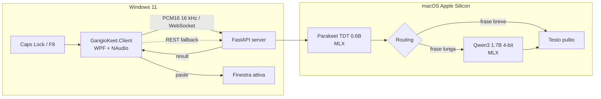

<p align="center">
  
</p>

<h1 align="center">GangioKeet</h1>

<p align="center">
  <strong>Dettatura vocale locale, push-to-talk, per macOS + Windows.</strong><br/>
  Il clone casalingo di Wispr Flow che non paga l'abbonamento.
</p>

<p align="center">
  <a href="LICENSE"></a>
  
  
  
  
  <a href="https://github.com/hal9ooo/GangioKeet/actions/workflows/security.yml"></a>
</p>

> **TL;DR** — Tieni premuto **Caps Lock**, parla, rilascia. Il testo appare
> nella finestra attiva. Audio, modelli e trascrizioni restano sulla tua
> macchina: nessun cloud, nessun account, nessun abbonamento.

## Indice

- [Perché esiste](#perché-esiste)
- [Cosa sa fare](#cosa-sa-fare)
- [Architettura](#architettura)
- [Quick start](#quick-start)
- [Come si usa](#come-si-usa)
- [Configurazione](#configurazione)
- [Privacy e sicurezza](#privacy-e-sicurezza)
- [Performance](#performance)
- [Dettagli tecnici](#dettagli-tecnici)
- [Sviluppo e test](#sviluppo-e-test)
- [Limiti](#limiti)
- [Crediti](#crediti)
- [Licenza](#licenza)

## Perché esiste

Wispr Flow è fantastico. Il suo abbonamento da **12 €/mese** un po' meno.

Quindi ho fatto quello che farebbe qualsiasi persona ragionevole: invece di
pagare, ho passato qualche sera a costruire un clone casalingo. Il risultato è
**GangioKeet**: premi un tasto, parli, il testo appare dove stai scrivendo.
La differenza è che l'audio non esce di casa, i modelli girano sul mio Mac e il
conto mensile è **0 €**.

Il nome? **Gangio** + **Parakeet**, il modello STT che ascolta e scrive.
GangioKeet è un progetto indipendente, non affiliato a Wispr Flow: è solo un
modo divertente di risolvere lo stesso problema senza abbonamento.

Se hai un Mac Apple Silicon e un PC Windows, puoi usarlo anche tu. Se non li
hai, puoi sempre leggere l'architettura e rubare qualche idea. 😄

## Cosa sa fare

- **Push-to-talk come Wispr Flow**: tieni premuto **Caps Lock** (o F8), parla,
  rilascia. Doppio tap per la modalità hands-free, **Esc** per annullare.
- **Tutto in locale**: Parakeet TDT 0.6B per lo STT e Qwen3 1.7B 4-bit per la
  pulizia del testo, entrambi su MLX/Apple Silicon. Niente cloud, account o
  telemetria.
- **Context-aware**: profili `code`, `terminal`, `chat`, `email`, `document`
  scelti in base all'app e al titolo della finestra; regole speciali per i
  browser (Gmail, GitHub, Slack, Google Docs…).
- **WebSocket + REST**: streaming PCM a bassa latenza; se il WebSocket non è
  disponibile, il client fa fallback via REST.
- **Qualità della vita**: pill flottante, tray, scelta del microfono, recupero
  dell'ultima dettatura, paste con clipboard preservata.
- **Privacy by default**: log senza contenuto, nessuno storico su disco; la
  registrazione per i benchmark è opt-in e protetta da permessi `0700`/`0600`.

## Architettura

GangioKeet è diviso in due parti perché i modelli MLX girano su Apple Silicon,
mentre microfono, tastiera e paste vivono sul PC Windows.



Il flusso, in breve:

1. Il client Windows cattura l'audio WASAPI, lo converte in PCM16 mono 16 kHz
   e lo manda al server via WebSocket.
2. Il server tiene Parakeet e Qwen in memoria. Un solo `asyncio.Lock`
   serializza l'accesso a Metal; il system prompt del LLM è prefillato e
   congelato a boot.
3. Parakeet trascrive. Se la frase è breve e non contiene trigger di
   autocorrezione o override fonetici, il server salta l'LLM (**fast path**).
   Altrimenti Qwen sistema punteggiatura, autocorrezioni e glossario.
4. Il testo torna al client, che lo incolla nella finestra attiva con la
   clipboard preservata e **senza premere Enter**.

**Perché due macchine?** Perché MLX è il modo più veloce per far girare
Parakeet e Qwen su un Mac Apple Silicon, e perché il client deve stare sulla
scrivania Windows dove lavori. Il server è un demone locale: non c'è un
servizio cloud in mezzo.

## Quick start

### Requisiti

| Parte | Serve |
|---|---|
| **Server** | macOS su Apple Silicon, [uv](https://docs.astral.sh/uv/); `ffmpeg` opzionale per i formati compressi via REST |
| **Client** | Windows 11 (Windows 10 non certificato), .NET 10 SDK |

### 1. Server (Mac)

```bash
git clone https://github.com/hal9ooo/GangioKeet.git
cd GangioKeet
uv sync
uv run python -m dictation_server.main
```

Al primo avvio scarica i modelli (diversi GB) e fa il warm-up: aspetta che
`/ready` risponda prima di dettare.

```bash
curl -s http://127.0.0.1:8000/health
curl -s http://127.0.0.1:8000/ready
```

Il server ascolta su `0.0.0.0:8000` per permettere al client sulla LAN di
raggiungerlo. Se vuoi solo locale, imposta `server.host: 127.0.0.1` in
`config.yaml`.

### 2. Client (Windows)

```powershell
git clone https://github.com/hal9ooo/GangioKeet.git
cd GangioKeet
New-Item -ItemType Directory -Force "$env:APPDATA\GangioKeet" | Out-Null
Copy-Item client-windows\client_config.example.yaml "$env:APPDATA\GangioKeet\client_config.yaml"
# apri il file e imposta server.host con l'IP del Mac
dotnet build client-windows\GangioKeet.Client.sln
dotnet run --project client-windows\src\GangioKeet.Client
```

Il client parte in tray, senza finestra principale. Se il server è dietro un
terminatore TLS, imposta anche `server.scheme: https`: il client userà
`https://` e `wss://`.

### 3. La prima dettatura

Tieni premuto **Caps Lock**, di' qualcosa, rilascia. Il testo appare nella
finestra attiva. Doppio tap su Caps Lock per la modalità hands-free, **Esc** per
annullare.

### 4. LaunchAgent (opzionale, macOS)

```bash
./deploy/install_launchd.sh
# per avviare il server già in modalità registrazione:
GANGIOKEET_RECORDING=1 ./deploy/install_launchd.sh
```

L'installer sostituisce `__PROJECT_DIR__` e `__HOME__` con il checkout e la
home dell'utente, scrive il plist locale con permessi `0600` e avvia il job.
Se sposti il progetto, rilancia l'installer.

### 5. Autenticazione (opzionale)

L'auth è disattivata finché `security.api_key_env` resta `null`. Per attivarla:

```yaml
security:
  api_key_env: "GANGIOKEET_API_KEY"
```

```bash
export GANGIOKEET_API_KEY="$(openssl rand -hex 32)"
uv run python -m dictation_server.main
```

Sul client, imposta lo stesso nome di variabile:

```yaml
server:
  api_key_env: "GANGIOKEET_API_KEY"
```

Il token vive solo nell'ambiente, mai nel YAML. `/health` resta pubblico; tutte
le altre rotte HTTP e il WebSocket sono protetti. Con l'auth attiva il token
viaggia comunque in chiaro su HTTP, a meno di TLS: usa una rete fidata o un
terminatore TLS.

### Accesso remoto via Tailscale

Il server ascolta su `0.0.0.0`, quindi è raggiungibile anche sull'interfaccia
Tailscale del Mac senza modifiche al codice. Sul Mac:

```bash
tailscale ip -4
curl -s "http://$(tailscale ip -4):8000/health"
```

Sul client Windows, imposta `server.host` all'IP Tailscale (o al nome MagicDNS)
del Mac. Il traffico del tailnet è cifrato da WireGuard, ma il server continua a
non implementare TLS: **non esporlo su Internet**. Con l'autenticazione attiva
il token resta protetto dal tunnel; senza API key, qualunque dispositivo del
tailnet può usare STT e LLM.

## Come si usa

| Azione | Come |
|---|---|
| Dettatura push-to-talk | Tieni premuto **Caps Lock** (o F8) e parla |
| Hands-free | Doppio tap su **Caps Lock** |
| Annulla | **Esc** |
| Cambia microfono | Tray → **Microfono** → predefinito o dispositivo |
| Recupera l'ultima dettatura | Tray → **Riprova**, **Copia ultimo testo**, **Scarta** |
| Configurazione | Tray → **Apri configurazione** (`%APPDATA%\GangioKeet\client_config.yaml`) |
| Pill | In basso al centro; `ui.pill_position: cursor` la fa apparire vicino al puntatore |

Il testo viene **incollato**, non inviato: nessun Enter automatico. Il client
non legge la clipboard e non fa Ctrl+C; se il paste fallisce, il testo resta
recuperabile per 600 secondi.

### Profili automatici

Il client sceglie il profilo in base alla finestra attiva:

| Profilo | Esempi |
|---|---|
| `code` | VS Code, Visual Studio, Cursor, PyCharm |
| `terminal` | Windows Terminal, cmd, PowerShell |
| `chat` | Slack, Teams, Discord, Telegram |
| `email` | Outlook, Thunderbird |
| `document` | Word, Obsidian, Notion |
| `default` | Tutto il resto |

Per i browser valgono le regole sul titolo della pagina: Gmail/Outlook/Proton
Mail → `email`, WhatsApp/Telegram/Slack/Discord/Teams → `chat`,
GitHub/GitLab/Stack Overflow → `code`, Google Docs/Notion/Overleaf → `document`.

La pill mostra lo stato: registrazione, connessione, elaborazione, errore. Se
Windows nega il microfono, il client propone di aprire le impostazioni sulla
privacy del microfono.

## Configurazione

### Server

`config.yaml` (estratto: il file completo contiene 21 termini canonici e 13
override fonetici):

```yaml
server:
  host: "0.0.0.0"
  port: 8000
  stt_model: "mlx-community/parakeet-tdt-0.6b-v3"
  llm_model: "mlx-community/Qwen3-1.7B-4bit"

limits:
  max_audio_bytes: 67108864
  max_http_body_bytes: 68157440
  max_buffered_audio_bytes: 201326592
  max_sessions: 4
  max_pending_jobs: 2

timeouts:
  upload_seconds: 10.0
  decode_seconds: 5.0
  queue_seconds: 2.0
  processing_seconds: 10.0
  llm_seconds: 5.0

security:
  api_key_env: null  # oppure "GANGIOKEET_API_KEY"

recording:
  enabled: false        # oppure avvia con --recording
  directory: "recordings"
  store_context: false  # app_name/window_title; selected_text mai

routing:
  fast_path_max_words: 5
  self_correction_triggers: ["anzi", "scusa", "aspetta", "cioè", "o meglio", "volevo dire"]

glossary:
  canonical_terms: ["FastAPI", "Proxmox VE", "MLX", "WebSocket"]
  phonetic_overrides:
    "fast a pi": "FastAPI"
    "emme elle ics": "MLX"
```

- `routing.fast_path_max_words`: sotto questa soglia l'LLM viene saltato,
  salvo trigger o override fonetici presenti nel testo.
- `routing.self_correction_triggers`: frasi che forzano il post-processing.
- `glossary.canonical_terms` e `glossary.phonetic_overrides` vengono iniettati
  nel system prompt congelato a boot; cambiarli richiede un riavvio.
- Il file è validato con `extra="forbid"`: chiavi sconosciute sono errori.
- Tutti i valori numerici di `limits` e `timeouts` devono essere positivi;
  `max_audio_bytes` non può superare né `max_buffered_audio_bytes` né
  `max_http_body_bytes`.

#### Limiti e timeout

| Impostazione | Default | Effetto |
|---|---:|---|
| `limits.max_audio_bytes` | 67.108.864 (64 MiB) | PCM massimo trattenuto per sessione WS e audio massimo accettato dal REST, incluso `format=pcm`. |
| `limits.max_http_body_bytes` | 68.157.440 (65 MiB) | Corpo HTTP massimo per `POST /v1/audio/transcriptions`. Controllato prima del multipart e, per richieste chunked, contando i byte ricevuti. |
| `limits.max_buffered_audio_bytes` | 201.326.592 (192 MiB) | Budget di audio trattenuto condiviso fra WebSocket e REST. Esaurito il budget, la richiesta fallisce con `busy`. |
| `limits.max_sessions` | 4 | Sessioni audio contemporanee (WS + REST). Oltre il limite: `busy`. |
| `limits.max_pending_jobs` | 2 | Job in coda oltre a quello attivo. Coda piena: `busy` immediato. |
| `timeouts.upload_seconds` | 10,0 | Tempo per ricevere il corpo REST. Allo scadere: `upload_timeout` (408). |
| `timeouts.decode_seconds` | 5,0 | Decodifica WAV/ffmpeg. Allo scadere: `decode_timeout` (504). |
| `timeouts.queue_seconds` | 2,0 | Attesa in coda prima dello start. Allo scadere: `queue_timeout` (503). |
| `timeouts.processing_seconds` | 10,0 | Limite rigido del job attivo, STT + LLM. Allo scadere: `processing_timeout` (504 lato REST, 1013 lato WS) e drain. |
| `timeouts.llm_seconds` | 5,0 | Deadline cooperativa del cleaner LLM. Allo scadere il server usa il testo normalizzato con warning `llm_timeout`, entro il limite di processing. |

Il limite del corpo HTTP è più alto di quello audio perché comprende
l'overhead multipart. Il PCM grezzo dichiarato con `format=pcm` resta comunque
soggetto a `max_audio_bytes`. `max_audio_bytes` è anche il `ws_max_size`
passato a uvicorn, quindi un frame oltre il limite viene rifiutato prima di
essere accodato.

### Client

La configurazione del client vive in `%APPDATA%\GangioKeet\client_config.yaml`.
Il file di esempio è `client-windows/client_config.example.yaml`; lo schema è
strict e le chiavi sconosciute vengono rifiutate. Le voci principali:

| Sezione | Cosa contiene |
|---|---|
| `server` | `host`, `scheme` (`http` default / `https`), `port`, `transport` (`websocket`/`rest`), timeout, `rest_fallback`, `api_key_env` |
| `hotkey` | `mode` (`push_to_talk`/`toggle`), `key` (`capslock` default, f1–f24, mouse_x1), `abort_key` (escape) |
| `audio` | `input_device` (`null` = default Windows), sample rate 16000, mono, chunk 100 ms |
| `paste` | combo `ctrl+v`/`ctrl+shift+v`, app terminale, delay clipboard, refocus |
| `ui` | pill flottante, posizione (`center_bottom`/`cursor`), feedback sonoro |
| `context_profiles` | mappe exe → profilo |
| `browser_profiles` | browser e regole per titolo |
| `recovery` | retention dell'ultima dettatura (default 600 s) |

Dettagli completi: [`client-windows/README.md`](client-windows/README.md).

### Registrazione opt-in

La registrazione è **spenta di default** e non salva nulla. Per raccogliere un
corpus delle proprie dettature:

```bash
uv run python -m dictation_server.main --recording
# equivalente: recording.enabled: true in config.yaml
```

Ogni dettatura completata (WebSocket o REST) scrive:

- `recordings/audio/<id>.wav`: PCM16 mono 16 kHz, permessi `0600`;
- una riga in `recordings/manifest.jsonl`: testo `raw_text`/`final_text`,
  profilo, trasporto, durata, modelli, metriche e SHA-256 dell'audio.

Il manifest è già nel formato del corpus di `scripts/stt_eval.py`.
`reference_raw` e `reference_final` partono vuoti e vanno annotati a mano:
finché restano vuoti la raccolta non produce un WER. `selected_text` non viene
mai salvato; `app_name` e `window_title` solo con
`recording.store_context: true`. La directory è `0700`, i file sono `0600`.
Le dettature annullate o fallite non vengono registrate e un errore di
scrittura non fa fallire la dettatura. Non c'è pulizia automatica: la
retention è manuale. `recordings/` è ignorata da git.

## Privacy e sicurezza

- **Nessun cloud**: audio, trascrizioni e modelli restano sulla tua macchina.
  Non ci sono account, telemetria o chiamate a servizi esterni durante l'uso.
- **Log senza contenuto**: i log contengono codici, durate, byte, profondità di
  coda e stato; mai testo dettato, prompt, titoli delle finestre o token.
- **Nessuno storico su disco**: audio e trascrizioni vivono in RAM. L'unica
  eccezione è la registrazione opt-in descritta sopra.
- **LAN, non Internet**: il server non implementa TLS, rate limiting o
  multi-tenancy. Di default token e audio viaggiano in chiaro su HTTP/WS; usa
  una rete fidata, Tailscale/VPN, o `server.scheme: https` dietro un
  terminatore TLS. Non esporre il server su Internet.
- **Auth opzionale**: se più persone condividono la LAN, attiva
  `security.api_key_env` e impostala anche sul client. `/health` resta pubblico;
  tutte le altre rotte e il WebSocket sono protetti.
- **Segnalazioni**: non aprire una issue pubblica per una vulnerabilità; vedi
  [`SECURITY.md`](SECURITY.md).

## Performance

Numeri reali, senza marketing. Il default resta **Parakeet** per la latenza; il
benchmark pubblico è uno screening, non una promozione automatica del modello
migliore in assoluto.

| Benchmark | Risultato |
|---|---|
| FLEURS italiano, 30 clip, Parakeet 0.6B | **3,88% WER raw**, p50 849 ms, p95 1060 ms |
| FLEURS italiano, Qwen3-ASR 1.7B 8-bit | **2,01% WER raw**, p50 2251 ms, p95 3343 ms |
| FLEURS italiano, Whisper turbo fp16 | **2,81% WER raw**, p50 1868 ms |
| Smoke M1/8 GB, 3,9 s, con LLM | `stop → result` p50 **1041 ms**; STT ~559 ms; LLM ~479 ms |
| Smoke M1/8 GB, fast path | `stop → result` p50 **570 ms**; STT ~558 ms |

I target di latenza `< 400 ms` **non sono raggiunti** su un MacBook Air M1 con
8 GB: lo STT ha un costo fisso di circa 558–576 ms anche su un audio di 3,9 s.
Il fast path elimina l'LLM ma resta dominato dallo STT. I numeri sono quelli
reali, senza cambiare la definizione delle metriche.

<details>
<summary><strong>Numeri completi e caveat</strong></summary>

**Smoke benchmark** del 26 ottobre 2026, server in-process dopo warm-up,
30 campioni per modalità e 2 warm-up, MacBook Air M1/8 GB, macOS 27.0.1,
mlx 0.32.4, mlx-lm 0.32.2, parakeet-mlx 0.5.3, audio sintetico da 3,9 s
(124.848 byte, chunk da 3200 byte), caricamento modelli + freeze 6,83 s,
warm-up 1,08 s.

| Metrica (ms) | p50 | p95 | max |
|---|---:|---:|---:|
| WebSocket `stop` → `result` (LLM) | 1041,4 | 1053,6 | 1059,8 |
| WebSocket `stop` → `result` (fast path) | 570,1 | 577,7 | 577,7 |
| Pipeline `total_ms` (LLM) | 1039,1 | 1051,0 | 1057,7 |
| STT `stt_ms` (modalità LLM) | 558,9 | 566,4 | 575,8 |
| LLM `llm_ms` (modalità LLM) | 479,3 | 489,0 | 499,0 |
| LLM TTFT (`generate_step` → primo token) | 228,5 | 233,2 | 235,0 |
| Pipeline `total_ms` (fast path) | 567,5 | 574,9 | 575,4 |
| STT `stt_ms` (fast path) | 558,3 | 563,2 | 565,5 |

Memoria: RSS `ps` 297 MB dopo il warm-up, picco 944 MB; picco Metal 3113 MB.
Su memoria unificata la RSS di `ps` non rappresenta la memoria realmente
impegnata da MLX: il dato Metal è quello significativo. **RSS e Metal non
vanno sommati.**

Questo è uno **smoke benchmark** su un singolo audio sintetico: non è il
confronto completo sul corpus da 60 clip e non misura qualità, WER o RTF.
Il benchmark pubblico FLEURS usa 30 registrazioni (21 frasi uniche, 15 corte +
15 medie), licenza CC-BY-4.0, e resta uno screening: non copre
sistematicamente termini tecnici, identificatori, path, numeri,
autocorrezioni, silenzi o il dominio reale.

</details>

Per riprodurre:

```bash
uv run python scripts/benchmark_mac.py --samples 30 --warmups 2
```

Il benchmark completo FLEURS è in `scripts/stt_eval*.py`; il corpus audio è
locale e ignorato da git. La fixture `tests/fixtures/it_short.pcm` è una frase
sintetica generata con `say -v Alice`, non la mia voce.

## Dettagli tecnici

<details>
<summary><strong>Protocollo WebSocket</strong></summary>

Endpoint: `ws://<host>:8000/ws/dictate`.

Stati: `idle → recording → processing → idle`. Un `start` è accettato solo in
`idle`; `stop` solo in `recording`; `abort` in `recording` o `processing`.
Dopo `abort` il server cancella e drena il worker prima di accettare un nuovo
`start`, e non invia alcun `result` per la richiesta annullata.

Messaggi client:

```json
{"type": "start", "app_name": "...", "window_title": "...",
 "profile": "code", "selected_text": "", "bypass_llm": false}
```

`profile` è uno di `code`, `terminal`, `chat`, `email`, `document`, `default`.
`selected_text`, `app_name` e `window_title` sono solo metadati: non entrano
nel prompt del post-processore.

Audio: frame binari PCM16 signed little-endian, mono, 16 kHz. I chunk vengono
accodati in RAM; il limite per sessione è `limits.max_audio_bytes` (default
64 MiB). Un singolo frame oltre `ws_max_size` (lo stesso valore, passato a
uvicorn) viene chiuso dal layer WebSocket con codice 1009. Se è il buffer
cumulativo a superare il limite, il server invia
`{"type":"error","code":"payload_too_large"}` e chiude con codice 1009.

```json
{"type": "stop"}
{"type": "abort"}
```

Risposte:

```json
{"type": "result", "raw_text": "...", "final_text": "...",
 "fast_path": false, "warnings": [],
 "metrics": {"stt_ms": 123.4, "llm_ms": 456.7, "total_ms": 580.1}}
```

`warnings` è additivo: contiene codici stabili come `llm_timeout` o
`llm_failed` quando il post-processing fallisce e il server usa il testo
normalizzato. `fast_path` resta `false` dopo qualunque tentativo LLM, anche
se il risultato proviene dal fallback.

`fast_path` è `true` quando l'LLM è stato saltato: testo sotto la soglia,
nessun trigger di autocorrezione, nessun override fonetico, oppure
`bypass_llm: true`. In quel caso `metrics.llm_ms` è `0.0`. Gli errori di
protocollo non chiudono la connessione:

```json
{"type": "error", "code": "protocol", "message": "...", "retryable": false}
```

Audio binario fuori da `recording`, JSON non valido, messaggi sconosciuti e
transizioni di stato non valide producono `code="protocol"`. PCM con un numero
dispari di byte produce `code="invalid_audio"` senza chiamare gli engine e la
sessione torna `idle`. Un errore interno della pipeline produce
`code="internal"` con messaggio generico e riporta lo stato a `idle`.

| Codice | `retryable` | Chiusura WS |
|---|---|---|
| `unauthorized` | `false` | `1008` prima di `start`/audio |
| `busy` | `true` | `1013` |
| `queue_timeout` | `true` | nessuna: la connessione resta riusabile |
| `processing_timeout` | `true` | `1013`; il drain continua in background |
| `invalid_audio` | `false` | nessuna: la connessione torna `idle` |
| `payload_too_large` | `false` | `1009` |
| `internal` | `false` | nessuna: messaggio generico |

Esempio Python:

```python
import asyncio, json, websockets

async def main():
    async with websockets.connect("ws://127.0.0.1:8000/ws/dictate") as ws:
        await ws.send(json.dumps({
            "type": "start", "app_name": "demo", "window_title": "demo",
            "profile": "chat", "bypass_llm": False,
        }))
        await ws.send(open("audio.pcm", "rb").read())
        await ws.send(json.dumps({"type": "stop"}))
        print(json.loads(await ws.recv()))

asyncio.run(main())
```

</details>

<details>
<summary><strong>REST OpenAI-compatible</strong></summary>

```bash
curl -s -X POST http://127.0.0.1:8000/v1/audio/transcriptions \
  -F file=@audio.wav \
  -F model=mlx-community/parakeet-tdt-0.6b-v3 \
  -F response_format=json
```

Parametri supportati:

| Campo | Note |
|---|---|
| `file` | Obbligatorio (multipart). |
| `model` | Opzionale; deve corrispondere al modello STT configurato o al suo basename. `whisper-1` e altri alias non sono accettati. |
| `response_format` | `json` (default) o `text`. `srt`, `vtt` e `verbose_json` non sono supportati. |
| `profile` | Estensione locale; default `default`. |
| `format` | Estensione locale in query string. `format=pcm` dichiara PCM16 mono 16 kHz grezzo. |
| `language` | Accettato solo assente o vuoto (anche solo spazi, no-op); un valore non vuoto restituisce `400 unsupported_parameter`. |
| `prompt` | Accettato solo assente o vuoto (anche solo spazi, no-op); un valore non vuoto restituisce `400 unsupported_parameter`. |
| `temperature` | Accettato solo assente/vuoto oppure un valore numerico uguale a `0`; il letterale `null` e ogni altro valore restituiscono `400 unsupported_parameter`. |
| `stream` | Accettato assente oppure `false`, `0`, `no`, `off`; `true` restituisce `400 unsupported_parameter`. |
| `timestamp_granularities`, `timestamp_granularities[]` | Accettati solo assenti o vuoti; valori non vuoti restituiscono `400 unsupported_parameter`. |

I campi multipart sconosciuti restituiscono `400 unsupported_parameter`. I
parametri query sconosciuti vengono ignorati per compatibilità. Gli errori di
validazione dei tipi generati dal framework possono mantenere il formato
`detail` a lista di FastAPI.

Selezione del decoder:

- `format=pcm` → passthrough diretto dei byte.
- WAV PCM16, mono, 16 kHz → letto in RAM con `wave`, senza `ffmpeg`.
- Altri WAV (float32, 24 bit, stereo, sample rate diverso) e formati compressi
  (MP3, M4A, ...) → `ffmpeg` via pipe stdin/stdout, nessun file temporaneo.
- Il content type generico `application/octet-stream` non viene mai
  interpretato come PCM grezzo: serve `format=pcm`.
- `ffmpeg` assente per un formato che lo richiede → HTTP 503.
- Formato non decodificabile o WAV strutturalmente invalido → HTTP 422.

Risposta `json`:

```json
{"text": "Testo finale.", "raw_text": "testo grezzo",
 "fast_path": false, "warnings": [],
 "metrics": {"stt_ms": 123.4, "llm_ms": 456.7, "total_ms": 580.1}}
```

`warnings` è additivo e non cambia le chiavi storiche. `response_format=text`
restituisce `text/plain` con il solo `text`; se ci sono warning aggiunge
l'header `X-GangioKeet-Warnings` con i codici separati da virgola, mentre non
aggiunge nulla quando la lista è vuota.

Errori REST (oltre ai `422` di validazione del framework):

| Codice | HTTP | Note |
|---|---|---|
| `unauthorized` | `401` | Auth Bearer attiva. |
| `busy` | `503` | `Retry-After: 1`. |
| `queue_timeout` | `503` | `Retry-After: 1`. |
| `decode_timeout` | `504` | |
| `upload_timeout` | `408` | |
| `processing_timeout` | `504` | |
| `invalid_audio` | `422` | PCM malformato, mai `500`. |
| `payload_too_large` | `413` | |
| `unsupported_parameter` | `400` | |
| `decoder_unavailable` | `503` | |
| `internal` | `500` | Messaggio generico. |

Il corpo è sempre `{"detail": {"code": "...", "message": "...",
"retryable": true|false}}`.

</details>

## Sviluppo e test

**Server** (macOS/MLX):

```bash
uv run pytest -q
RUN_REAL_MODELS=1 uv run pytest tests/integration -v
```

**Client** (Windows):

```powershell
dotnet test client-windows/GangioKeet.Client.sln --filter "Category!=Integration"
$env:RUN_DESKTOP_TESTS="1"
$env:RUN_REAL_SERVER="1"
$env:GANGIOKEET_HOST="<IP_DEL_MAC>:8000"
dotnet test client-windows/GangioKeet.Client.sln --filter "Category=Integration"
```

La suite client di default usa fake; i test `Integration` toccano clipboard,
finestra in primo piano, microfono, registry o un server reale e sono gated.
La fixture audio è sintetica, quindi puoi eseguire i test senza registrare la
tua voce.

Struttura del repo:

```
dictation_server/    server FastAPI, scheduler, STT/LLM, auth, recording
client-windows/     client WPF (hotkey, audio WASAPI, paste, tray, pill)
deploy/             LaunchAgent macOS
scripts/            benchmark e STT evaluation
tests/              pytest del server
assets/             icona
```

## Limiti

- Il server è pensato per la **rete locale**: niente TLS, rate limiting o
  multi-tenancy. Token e audio viaggiano in chiaro su HTTP/WS; usa una rete
  fidata, Tailscale/VPN o un terminatore TLS con `server.scheme: https`.
- Un solo processo e un solo lock Metal: le richieste concorrenti vengono
  serializzate da uno scheduler FIFO a worker singolo. Coda e budget audio sono
  condivisi fra WebSocket e REST.
- Lo scheduler rende visibile il timeout e impedisce l'overlap, ma non
  guarisce un kernel bloccato per sempre: se il kernel non ritorna, il job va
  in `processing_timeout`, il servizio resta `busy`/`draining` e `/health`
  continua a rispondere; serve un riavvio operativo.
- I log contengono solo codici, durate, byte, profondità di coda e stato di
  drain: testo dettato, prompt, nomi file, titoli delle finestre e token non
  vengono mai registrati.
- L'audio di input deve essere PCM16 mono 16 kHz; il REST converte solo se
  `ffmpeg` è disponibile.
- Il campo `model` del REST deve corrispondere al modello STT configurato; non
  è un proxy per modelli OpenAI.
- Nessun streaming parziale dei risultati: il client riceve un solo `result`
  dopo `stop` (o nessun risultato dopo `abort`).
- I target di latenza sono gate sperimentali e dipendono da chip, RAM, modello
  e durata della dettatura; sul mio M1/8 GB i target `< 400 ms` non sono
  raggiunti.

## Crediti

- **STT**: [Parakeet TDT 0.6B](https://huggingface.co/mlx-community/parakeet-tdt-0.6b-v3) su MLX.
- **LLM**: [Qwen3 1.7B 4-bit](https://huggingface.co/mlx-community/Qwen3-1.7B-4bit) su MLX.
- **Server**: FastAPI, uvicorn, Pydantic.
- **Client**: WPF, NAudio, YamlDotNet, Hardcodet.NotifyIcon.Wpf.
- **Corpus**: FLEURS (CC-BY-4.0).
- **Icona**: wave-bird.
- **Ispirazione**: Wispr Flow.

## Licenza

MIT — vedi [`LICENSE`](LICENSE). Le trascrizioni FLEURS incluse nel manifest
restano sotto CC-BY-4.0; vedi [`THIRD_PARTY_NOTICES.md`](THIRD_PARTY_NOTICES.md).

Wispr Flow è un marchio del rispettivo proprietario. GangioKeet è un progetto
indipendente, non affiliato a Wispr Flow.

---

<p align="center">
  Fatto con ☕, un MacBook Air M1 e la testardaggine di non voler pagare
  l'abbonamento.
</p>
