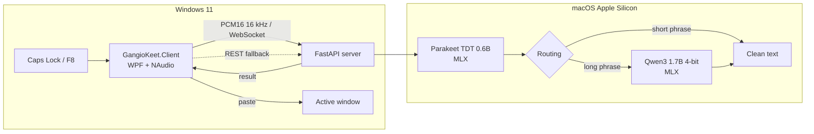

<p align="center">
  
</p>

<h1 align="center">GangioKeet</h1>

<p align="center">
  <strong>Local push-to-talk dictation for macOS + Windows.</strong><br/>
  The homegrown Wispr Flow clone that refuses to pay the subscription.
</p>

<p align="center">
  <a href="LICENSE"></a>
  
  
  
  
  <a href="https://github.com/hal9ooo/GangioKeet/actions/workflows/security.yml"></a>
</p>

> **TL;DR** — Hold **Caps Lock**, talk, release. The text appears in the active
> window. Audio, models, and transcripts stay on your machines: no cloud, no
> account, no subscription.

## Contents

- [Why this exists](#why-this-exists)
- [What it does](#what-it-does)
- [Architecture](#architecture)
- [Quick start](#quick-start)
- [How to use](#how-to-use)
- [Configuration](#configuration)
- [Privacy and security](#privacy-and-security)
- [Performance](#performance)
- [Technical details](#technical-details)
- [Development and tests](#development-and-tests)
- [Limits](#limits)
- [Credits](#credits)
- [License](#license)

## Why this exists

Wispr Flow is genuinely great. Its **€12/month** subscription is also
genuinely great — for them.

So I did what any reasonable person would do: instead of paying, I built my own
clone. My weekends are gone, but my wallet is happy. The result is
**GangioKeet**: hold a key, talk, and the text appears wherever you were
typing. The audio never leaves your machines, the models run on your Mac, and
the monthly bill is **€0**.

The name? **Gangio** + **Parakeet**, the speech model that does the listening.
The bird on the icon is a wave-bird, because apparently a parakeet made of
sound waves was the only logical choice.

GangioKeet is an independent project, not affiliated with Wispr Flow. It is
just a fun, slightly obsessive homegrown alternative to a subscription. If you
have a Mac Apple Silicon and a Windows PC, you are the target audience. If you
don't, feel free to read the architecture and steal some ideas. 😄

## What it does

- **Push-to-talk, Wispr Flow style**: hold **Caps Lock** (or F8), talk, release.
  Double-tap for hands-free, **Esc** to abort.
- **Fully local**: Parakeet TDT 0.6B for speech-to-text and Qwen3 1.7B 4-bit for
  cleanup, both on MLX/Apple Silicon. No cloud, no account, no telemetry.
- **Context-aware**: `code`, `terminal`, `chat`, `email`, and `document`
  profiles chosen from the active app and window title, with special rules for
  browsers (Gmail, GitHub, Slack, Google Docs…).
- **WebSocket + REST**: low-latency PCM streaming over WebSocket, with a REST
  fallback when the WebSocket cannot be established.
- **Quality of life**: floating pill, tray menu, microphone picker, last
  dictation recovery, and clipboard-preserving paste.
- **Privacy by default**: content-free logs, no on-disk history; benchmark
  recording is opt-in and protected with `0700`/`0600` permissions.

## Architecture

GangioKeet has two halves because MLX runs on Apple Silicon, while the
microphone, keyboard, and paste live on the Windows PC.



The flow, in short:

1. The Windows client captures WASAPI audio, converts it to PCM16 mono 16 kHz,
   and sends it to the server over WebSocket.
2. The server keeps Parakeet and Qwen in memory. A single `asyncio.Lock`
   serializes Metal access; the LLM system prompt is prefilled and frozen at
   boot.
3. Parakeet transcribes. If the phrase is short and contains no self-correction
   triggers or phonetic overrides, the server skips the LLM (**fast path**).
   Otherwise Qwen fixes punctuation, self-corrections, and glossary terms.
4. The text goes back to the client, which pastes it into the active window
   with clipboard preservation and **without pressing Enter**.

**Why two machines?** Because MLX is the fastest way to run Parakeet and Qwen
on an Apple Silicon Mac, and because the client belongs on the Windows desktop
where you actually work. The server is a local daemon; there is no cloud in the
middle.

## Quick start

### Requirements

| Part | What you need |
|---|---|
| **Server** | macOS on Apple Silicon, [uv](https://docs.astral.sh/uv/); `ffmpeg` optional for compressed formats over REST |
| **Client** | Windows 11 (Windows 10 is not certified), .NET 10 SDK |

### 1. Server (Mac)

```bash
git clone https://github.com/hal9ooo/GangioKeet.git
cd GangioKeet
uv sync
uv run python -m dictation_server.main
```

The first run downloads the models (several GB) and warms up. Wait for
`/ready` before dictating.

```bash
curl -s http://127.0.0.1:8000/health
curl -s http://127.0.0.1:8000/ready
```

The server listens on `0.0.0.0:8000` so the Windows client can reach it on the
LAN. If you want loopback only, set `server.host: 127.0.0.1` in `config.yaml`.

### 2. Client (Windows)

```powershell
git clone https://github.com/hal9ooo/GangioKeet.git
cd GangioKeet
New-Item -ItemType Directory -Force "$env:APPDATA\GangioKeet" | Out-Null
Copy-Item client-windows\client_config.example.yaml "$env:APPDATA\GangioKeet\client_config.yaml"
# edit the file and set server.host to the Mac's IP
dotnet build client-windows\GangioKeet.Client.sln
dotnet run --project client-windows\src\GangioKeet.Client
```

The client starts in the tray with no main window. If the server sits behind a
TLS terminator, also set `server.scheme: https`: the client will use `https://`
and `wss://`.

### 3. First dictation

Hold **Caps Lock**, say something, release. The text appears in the active
window. Double-tap Caps Lock for hands-free mode; press **Esc** to abort.

### 4. LaunchAgent (optional, macOS)

```bash
./deploy/install_launchd.sh
# start it in recording mode:
GANGIOKEET_RECORDING=1 ./deploy/install_launchd.sh
```

The installer replaces `__PROJECT_DIR__` and `__HOME__` with the checkout and
the user's home, writes the local plist with `0600` permissions, and loads the
job. If you move the project, run the installer again.

### 5. Authentication (optional)

Auth stays off as long as `security.api_key_env` is `null`. To enable it:

```yaml
security:
  api_key_env: "GANGIOKEET_API_KEY"
```

```bash
export GANGIOKEET_API_KEY="$(openssl rand -hex 32)"
uv run python -m dictation_server.main
```

On the client, point to the same environment variable:

```yaml
server:
  api_key_env: "GANGIOKEET_API_KEY"
```

The token lives only in the environment, never in YAML. `/health` stays public;
every other HTTP route and the WebSocket are protected. With auth enabled the
token still travels in clear text over HTTP unless you add TLS, so use a
trusted network or a TLS terminator.

### Remote access over Tailscale

The server listens on `0.0.0.0`, so it is also reachable on the Mac's Tailscale
interface without code changes. On the Mac:

```bash
tailscale ip -4
curl -s "http://$(tailscale ip -4):8000/health"
```

On the Windows client, set `server.host` to the Mac's Tailscale IP (or its
MagicDNS name). Tailnet traffic is encrypted by WireGuard, but the server still
does not implement TLS: **do not expose it to the Internet**. With auth enabled
the token stays inside the tunnel; without an API key, any device on the
tailnet can use STT and the LLM.

## How to use

| Action | How |
|---|---|
| Push-to-talk | Hold **Caps Lock** (or F8) and speak |
| Hands-free | Double-tap **Caps Lock** |
| Abort | **Esc** |
| Change microphone | Use the microphone submenu in the tray |
| Recover the last dictation | Use the recovery actions in the tray (retry, copy, discard) |
| Configuration | Open the configuration from the tray (`%APPDATA%\GangioKeet\client_config.yaml`) |
| Pill | Bottom center; `ui.pill_position: cursor` puts it near the pointer |

The text is **pasted**, not sent: no automatic Enter. The client does not read
the clipboard and does not press Ctrl+C; if paste fails, the text stays
recoverable for 600 seconds.

### Automatic profiles

The client picks a profile from the active window:

| Profile | Examples |
|---|---|
| `code` | VS Code, Visual Studio, Cursor, PyCharm |
| `terminal` | Windows Terminal, cmd, PowerShell |
| `chat` | Slack, Teams, Discord, Telegram |
| `email` | Outlook, Thunderbird |
| `document` | Word, Obsidian, Notion |
| `default` | Everything else |

Browsers use page-title rules: Gmail/Outlook/Proton Mail → `email`,
WhatsApp/Telegram/Slack/Discord/Teams → `chat`, GitHub/GitLab/Stack Overflow →
`code`, Google Docs/Notion/Overleaf → `document`.

The pill shows recording, connecting, processing, and error states. If Windows
denies microphone access, the client offers to open the microphone privacy
settings.

## Configuration

### Server

`config.yaml` (excerpt: the full file contains 21 canonical terms and 13
phonetic overrides):

```yaml
server:
  host: "0.0.0.0"
  port: 8000
  stt_model: "mlx-community/parakeet-tdt-0.6b-v3"
  llm_model: "mlx-community/Qwen3-1.7B-4bit"

limits:
  max_audio_bytes: 67108864
  max_http_body_bytes: 68157440
  max_buffered_audio_bytes: 201326592
  max_sessions: 4
  max_pending_jobs: 2

timeouts:
  upload_seconds: 10.0
  decode_seconds: 5.0
  queue_seconds: 2.0
  processing_seconds: 10.0
  llm_seconds: 5.0

security:
  api_key_env: null  # or "GANGIOKEET_API_KEY"

recording:
  enabled: false        # or start with --recording
  directory: "recordings"
  store_context: false  # app_name/window_title; selected_text is never stored

routing:
  fast_path_max_words: 5
  self_correction_triggers: ["anzi", "scusa", "aspetta", "cioè", "o meglio", "volevo dire"]

glossary:
  canonical_terms: ["FastAPI", "Proxmox VE", "MLX", "WebSocket"]
  phonetic_overrides:
    "fast a pi": "FastAPI"
    "emme elle ics": "MLX"
```

- `routing.fast_path_max_words`: below this threshold the LLM is skipped unless
  the text contains a trigger or a phonetic override.
- `routing.self_correction_triggers`: phrases that force post-processing.
- `glossary.canonical_terms` and `glossary.phonetic_overrides` are injected into
  the system prompt frozen at boot; changing them requires a restart.
- The file is validated with `extra="forbid"`: unknown keys are errors.
- All `limits` and `timeouts` values must be positive; `max_audio_bytes` cannot
  exceed either `max_buffered_audio_bytes` or `max_http_body_bytes`.

#### Limits and timeouts

| Setting | Default | Effect |
|---|---:|---|
| `limits.max_audio_bytes` | 67,108,864 (64 MiB) | Maximum PCM retained per WebSocket session and maximum audio accepted by REST, including `format=pcm`. |
| `limits.max_http_body_bytes` | 68,157,440 (65 MiB) | Maximum HTTP body for `POST /v1/audio/transcriptions`. Checked before multipart parsing and, for chunked requests, while counting received bytes. |
| `limits.max_buffered_audio_bytes` | 201,326,592 (192 MiB) | Shared audio budget retained across WebSocket and REST. Once exhausted, the request fails with `busy`. |
| `limits.max_sessions` | 4 | Concurrent audio sessions (WS + REST). Above the limit: `busy`. |
| `limits.max_pending_jobs` | 2 | Jobs queued beyond the active one. Full queue: immediate `busy`. |
| `timeouts.upload_seconds` | 10.0 | Time to receive the REST body. On expiry: `upload_timeout` (408). |
| `timeouts.decode_seconds` | 5.0 | WAV/ffmpeg decoding. On expiry: `decode_timeout` (504). |
| `timeouts.queue_seconds` | 2.0 | Queue wait before start. On expiry: `queue_timeout` (503). |
| `timeouts.processing_seconds` | 10.0 | Hard limit for the active job, STT + LLM. On expiry: `processing_timeout` (504 on REST, 1013 on WS) and drain. |
| `timeouts.llm_seconds` | 5.0 | Cooperative deadline for the LLM cleaner. On expiry the server uses the normalized text with an `llm_timeout` warning, within the processing limit. |

The HTTP body limit is higher than the audio limit because it includes
multipart overhead. Raw PCM declared with `format=pcm` is still subject to
`max_audio_bytes`. `max_audio_bytes` is also the `ws_max_size` passed to
uvicorn, so a frame above the limit is rejected before it is queued.

### Client

The client configuration lives in `%APPDATA%\GangioKeet\client_config.yaml`.
The example is `client-windows/client_config.example.yaml`; the schema is
strict and unknown keys are rejected. The main sections:

| Section | What it contains |
|---|---|
| `server` | `host`, `scheme` (`http` default / `https`), `port`, `transport` (`websocket`/`rest`), timeouts, `rest_fallback`, `api_key_env` |
| `hotkey` | `mode` (`push_to_talk`/`toggle`), `key` (`capslock` default, f1–f24, mouse_x1), `abort_key` (escape) |
| `audio` | `input_device` (`null` = Windows default), sample rate 16000, mono, 100 ms chunks |
| `paste` | `ctrl+v`/`ctrl+shift+v`, terminal apps, clipboard delay, refocus |
| `ui` | floating pill, position (`center_bottom`/`cursor`), sound feedback |
| `context_profiles` | exe → profile mappings |
| `browser_profiles` | browsers and page-title rules |
| `recovery` | last-dictation retention (default 600 s) |

Full details: [`client-windows/README.md`](client-windows/README.md).

### Opt-in recording

Recording is **off by default** and saves nothing. To collect a corpus of your
own dictations:

```bash
uv run python -m dictation_server.main --recording
# equivalent: recording.enabled: true in config.yaml
```

Every completed dictation (WebSocket or REST) writes:

- `recordings/audio/<id>.wav`: PCM16 mono 16 kHz, `0600` permissions;
- one line in `recordings/manifest.jsonl`: `raw_text`/`final_text`, profile,
  transport, duration, models, metrics, and the audio SHA-256.

The manifest already matches the corpus format used by `scripts/stt_eval.py`.
`reference_raw` and `reference_final` start empty and must be filled in by hand:
until they are, the collection is a capture, not a WER benchmark.
`selected_text` is never stored; `app_name` and `window_title` are stored only
with `recording.store_context: true`. The directory is `0700`, files are
`0600`. Aborted or failed dictations are not recorded, and a write error does
not fail the dictation. There is no automatic cleanup: retention is manual.
`recordings/` is ignored by git.

## Privacy and security

- **No cloud**: audio, transcripts, and models stay on your machines. No
  accounts, telemetry, or external calls during normal use.
- **Content-free logs**: logs contain codes, durations, bytes, queue depth, and
  drain state; never dictated text, prompts, window titles, or tokens.
- **No on-disk history**: audio and transcripts live in RAM. The only exception
  is the opt-in recording described above.
- **LAN, not the Internet**: the server does not implement TLS, rate limiting,
  or multi-tenancy. By default tokens and audio travel in clear text over
  HTTP/WS; use a trusted network, Tailscale/VPN, or `server.scheme: https`
  behind a TLS terminator. Do not expose the server to the Internet.
- **Optional auth**: if other people share the LAN, enable
  `security.api_key_env` and set the same variable on the client. `/health`
  stays public; every other route and the WebSocket are protected.
- **Reports**: do not open a public issue for a vulnerability; see
  [`SECURITY.md`](SECURITY.md).

## Performance

Real numbers, no marketing. The default stays **Parakeet** for latency; the
public benchmark is a screening, not an automatic promotion of the model with
the best WER.

| Benchmark | Result |
|---|---|
| FLEURS Italian, 30 clips, Parakeet 0.6B | **3.88% raw WER**, p50 849 ms, p95 1060 ms |
| FLEURS Italian, Qwen3-ASR 1.7B 8-bit | **2.01% raw WER**, p50 2251 ms, p95 3343 ms |
| FLEURS Italian, Whisper turbo fp16 | **2.81% raw WER**, p50 1868 ms |
| Smoke test, M1/8 GB, 3.9 s, with LLM | `stop → result` p50 **1041 ms**; STT ~559 ms; LLM ~479 ms |
| Smoke test, M1/8 GB, fast path | `stop → result` p50 **570 ms**; STT ~558 ms |

The `< 400 ms` latency targets are **not met** on an M1 MacBook Air with 8 GB:
STT has a fixed cost of roughly 558–576 ms even on a 3.9 s clip. The fast path
removes the LLM but is still dominated by STT. These are the real numbers,
without changing the metric definitions.

<details>
<summary><strong>Full numbers and caveats</strong></summary>

**Smoke benchmark**, October 26, 2026, in-process server after warm-up,
30 samples per mode and 2 warm-ups, MacBook Air M1/8 GB, macOS 27.0.1,
mlx 0.32.4, mlx-lm 0.32.2, parakeet-mlx 0.5.3, synthetic 3.9 s audio
(124,848 bytes, 3200-byte chunks), model load + freeze 6.83 s, warm-up 1.08 s.

| Metric (ms) | p50 | p95 | max |
|---|---:|---:|---:|
| WebSocket `stop` → `result` (LLM) | 1041.4 | 1053.6 | 1059.8 |
| WebSocket `stop` → `result` (fast path) | 570.1 | 577.7 | 577.7 |
| Pipeline `total_ms` (LLM) | 1039.1 | 1051.0 | 1057.7 |
| STT `stt_ms` (LLM mode) | 558.9 | 566.4 | 575.8 |
| LLM `llm_ms` (LLM mode) | 479.3 | 489.0 | 499.0 |
| LLM TTFT (`generate_step` → first token) | 228.5 | 233.2 | 235.0 |
| Pipeline `total_ms` (fast path) | 567.5 | 574.9 | 575.4 |
| STT `stt_ms` (fast path) | 558.3 | 563.2 | 565.5 |

Memory: `ps` RSS 297 MB after warm-up, peak 944 MB; Metal peak 3113 MB. On
unified memory, `ps` RSS does not represent the memory actually used by MLX:
the Metal number is the meaningful one. **Do not add RSS and Metal together.**

This is a **smoke benchmark** on a single synthetic clip: it is not the full
60-clip corpus comparison and does not measure quality, WER, or RTF. The public
FLEURS benchmark uses 30 recordings (21 unique sentences, 15 short + 15
medium), CC-BY-4.0, and is still a screening: it does not systematically cover
technical terms, identifiers, paths, numbers, self-corrections, silence, or the
real-world domain.

</details>

To reproduce:

```bash
uv run python scripts/benchmark_mac.py --samples 30 --warmups 2
```

The full FLEURS benchmark lives in `scripts/stt_eval*.py`; the audio corpus is
local and gitignored. The `tests/fixtures/it_short.pcm` fixture is a synthetic
sentence generated with `say -v Alice`, not my voice.

## Technical details

<details>
<summary><strong>WebSocket protocol</strong></summary>

Endpoint: `ws://<host>:8000/ws/dictate`.

States: `idle → recording → processing → idle`. A `start` is accepted only in
`idle`; `stop` only in `recording`; `abort` in `recording` or `processing`.
After `abort` the server cancels and drains the worker before accepting a new
`start`, and sends no `result` for the aborted request.

Client messages:

```json
{"type": "start", "app_name": "...", "window_title": "...",
 "profile": "code", "selected_text": "", "bypass_llm": false}
```

`profile` is one of `code`, `terminal`, `chat`, `email`, `document`, `default`.
`selected_text`, `app_name`, and `window_title` are metadata only: they do not
enter the post-processor prompt.

Audio: binary frames, signed little-endian PCM16, mono, 16 kHz. Chunks are
buffered in RAM; the per-session limit is `limits.max_audio_bytes` (default
64 MiB). A single frame above `ws_max_size` (the same value, passed to uvicorn)
is closed by the WebSocket layer with code 1009. If the cumulative buffer
exceeds the limit, the server sends
`{"type":"error","code":"payload_too_large"}` and closes with code 1009.

```json
{"type": "stop"}
{"type": "abort"}
```

Responses:

```json
{"type": "result", "raw_text": "...", "final_text": "...",
 "fast_path": false, "warnings": [],
 "metrics": {"stt_ms": 123.4, "llm_ms": 456.7, "total_ms": 580.1}}
```

`warnings` is additive: it contains stable codes such as `llm_timeout` or
`llm_failed` when post-processing fails and the server falls back to the
normalized text. `fast_path` stays `false` after any LLM attempt, even when the
result comes from the fallback.

`fast_path` is `true` when the LLM was skipped: text below the threshold, no
self-correction trigger, no phonetic override, or `bypass_llm: true`. In that
case `metrics.llm_ms` is `0.0`. Protocol errors do not close the connection:

```json
{"type": "error", "code": "protocol", "message": "...", "retryable": false}
```

Binary audio outside `recording`, invalid JSON, unknown messages, and invalid
state transitions produce `code="protocol"`. PCM with an odd number of bytes
produces `code="invalid_audio"` without calling the engines and returns the
session to `idle`. An internal pipeline error produces `code="internal"` with a
generic message and returns the state to `idle`.

| Code | `retryable` | WebSocket close |
|---|---|---|
| `unauthorized` | `false` | `1008` before `start`/audio |
| `busy` | `true` | `1013` |
| `queue_timeout` | `true` | none: the connection stays reusable |
| `processing_timeout` | `true` | `1013`; drain continues in the background |
| `invalid_audio` | `false` | none: the connection returns to `idle` |
| `payload_too_large` | `false` | `1009` |
| `internal` | `false` | none: generic message |

Python example:

```python
import asyncio, json, websockets

async def main():
    async with websockets.connect("ws://127.0.0.1:8000/ws/dictate") as ws:
        await ws.send(json.dumps({
            "type": "start", "app_name": "demo", "window_title": "demo",
            "profile": "chat", "bypass_llm": False,
        }))
        await ws.send(open("audio.pcm", "rb").read())
        await ws.send(json.dumps({"type": "stop"}))
        print(json.loads(await ws.recv()))

asyncio.run(main())
```

</details>

<details>
<summary><strong>OpenAI-compatible REST</strong></summary>

```bash
curl -s -X POST http://127.0.0.1:8000/v1/audio/transcriptions \
  -F file=@audio.wav \
  -F model=mlx-community/parakeet-tdt-0.6b-v3 \
  -F response_format=json
```

Supported parameters:

| Field | Notes |
|---|---|
| `file` | Required (multipart). |
| `model` | Optional; must match the configured STT model or its basename. `whisper-1` and other aliases are rejected. |
| `response_format` | `json` (default) or `text`. `srt`, `vtt`, and `verbose_json` are not supported. |
| `profile` | Local extension; default `default`. |
| `format` | Local extension in the query string. `format=pcm` declares raw PCM16 mono 16 kHz. |
| `language` | Accepted only when absent or empty (even whitespace is a no-op); a non-empty value returns `400 unsupported_parameter`. |
| `prompt` | Accepted only when absent or empty (even whitespace is a no-op); a non-empty value returns `400 unsupported_parameter`. |
| `temperature` | Accepted only when absent/empty or a numeric value equal to `0`; the literal `null` and any other value return `400 unsupported_parameter`. |
| `stream` | Accepted only when absent or `false`, `0`, `no`, `off`; `true` returns `400 unsupported_parameter`. |
| `timestamp_granularities`, `timestamp_granularities[]` | Accepted only when absent or empty; non-empty values return `400 unsupported_parameter`. |

Unknown multipart fields return `400 unsupported_parameter`. Unknown query
parameters are ignored for compatibility. Framework type-validation errors may
keep FastAPI's `detail` list format.

Decoder selection:

- `format=pcm` → direct passthrough of the bytes.
- WAV PCM16, mono, 16 kHz → read in RAM with `wave`, no `ffmpeg`.
- Other WAV (float32, 24-bit, stereo, different sample rate) and compressed
  formats (MP3, M4A, ...) → `ffmpeg` via stdin/stdout pipes, no temporary files.
- The generic `application/octet-stream` content type is never interpreted as
  raw PCM: use `format=pcm`.
- Missing `ffmpeg` for a format that needs it → HTTP 503.
- Undecodable format or structurally invalid WAV → HTTP 422.

`json` response:

```json
{"text": "Final text.", "raw_text": "raw text",
 "fast_path": false, "warnings": [],
 "metrics": {"stt_ms": 123.4, "llm_ms": 456.7, "total_ms": 580.1}}
```

`warnings` is additive and does not change the historical keys.
`response_format=text` returns `text/plain` with only `text`; if there are
warnings it adds the `X-GangioKeet-Warnings` header with comma-separated codes,
and adds nothing when the list is empty.

REST errors (in addition to the framework's `422` validation errors):

| Code | HTTP | Notes |
|---|---|---|
| `unauthorized` | `401` | Bearer auth enabled. |
| `busy` | `503` | `Retry-After: 1`. |
| `queue_timeout` | `503` | `Retry-After: 1`. |
| `decode_timeout` | `504` | |
| `upload_timeout` | `408` | |
| `processing_timeout` | `504` | |
| `invalid_audio` | `422` | Malformed PCM, never `500`. |
| `payload_too_large` | `413` | |
| `unsupported_parameter` | `400` | |
| `decoder_unavailable` | `503` | |
| `internal` | `500` | Generic message. |

The body is always `{"detail": {"code": "...", "message": "...",
"retryable": true|false}}`.

</details>

## Development and tests

**Server** (macOS/MLX):

```bash
uv run pytest -q
RUN_REAL_MODELS=1 uv run pytest tests/integration -v
```

**Client** (Windows):

```powershell
dotnet test client-windows/GangioKeet.Client.sln --filter "Category!=Integration"
$env:RUN_DESKTOP_TESTS="1"
$env:RUN_REAL_SERVER="1"
$env:GANGIOKEET_HOST="<MAC_IP>:8000"
dotnet test client-windows/GangioKeet.Client.sln --filter "Category=Integration"
```

The default client suite uses fakes; `Integration` tests touch the clipboard,
foreground window, microphone, registry, or a real server and are gated. The
audio fixture is synthetic, so you can run tests without recording your voice.

Repository layout:

```
dictation_server/    FastAPI server, scheduler, STT/LLM, auth, recording
client-windows/     WPF client (hotkey, WASAPI, paste, tray, pill)
deploy/             macOS LaunchAgent
scripts/            benchmark and STT evaluation
tests/              server pytest suite
assets/             icon
```

## Limits

- The server is designed for the **local network**: no TLS, rate limiting, or
  multi-tenancy. Tokens and audio travel in clear text over HTTP/WS by default;
  use a trusted network, Tailscale/VPN, or a TLS terminator with
  `server.scheme: https`.
- One process and one Metal lock: concurrent requests are serialized by a
  single-worker FIFO scheduler. Queue and audio budget are shared between
  WebSocket and REST.
- The scheduler surfaces timeouts and prevents overlap, but it cannot heal a
  kernel stuck forever: if the kernel never returns, the job hits
  `processing_timeout`, the service stays `busy`/`draining`, and `/health` keeps
  responding; an operational restart is required.
- Logs contain only codes, durations, bytes, queue depth, and drain state:
  dictated text, prompts, file names, window titles, and tokens are never
  logged.
- Input audio must be PCM16 mono 16 kHz; REST converts only when `ffmpeg` is
  available.
- The REST `model` field must match the configured STT model; it is not a proxy
  for OpenAI models.
- No partial result streaming: the client receives a single `result` after
  `stop` (or no result after `abort`).
- Latency targets are experimental gates and depend on chip, RAM, model, and
  dictation length; on my M1/8 GB the `< 400 ms` targets are not met.

## Credits

- **STT**: [Parakeet TDT 0.6B](https://huggingface.co/mlx-community/parakeet-tdt-0.6b-v3) on MLX.
- **LLM**: [Qwen3 1.7B 4-bit](https://huggingface.co/mlx-community/Qwen3-1.7B-4bit) on MLX.
- **Server**: FastAPI, uvicorn, Pydantic.
- **Client**: WPF, NAudio, YamlDotNet, Hardcodet.NotifyIcon.Wpf.
- **Corpus**: FLEURS (CC-BY-4.0).
- **Icon**: wave-bird.
- **Inspiration**: Wispr Flow.

## License

MIT — see [`LICENSE`](LICENSE). FLEURS transcriptions in the manifest remain
under CC-BY-4.0; see [`THIRD_PARTY_NOTICES.md`](THIRD_PARTY_NOTICES.md).

Wispr Flow is a trademark of its respective owner. GangioKeet is an independent
project, not affiliated with Wispr Flow.

---

<p align="center">
  Built with ☕, a MacBook Air M1, and an unreasonable refusal to pay for a
  subscription.
</p>
