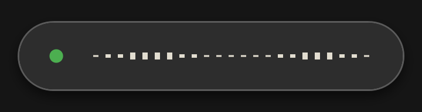

# GangioKeet v0.1.0

Local push-to-talk dictation for Windows. Hold **Caps Lock**, talk, release; the
text lands in the active window. No cloud, no account, no subscription.

  

## What's in this build

- **Local ASR**: Parakeet v3, Qwen3-ASR 1.7B, and experimental Nemotron 3.5
  Transcribe 30B A4B. Models are downloaded on demand, never bundled.
- **Refinement**: none, the deterministic **Pulizia leggera** (no model, no
  added latency), Gemma 4 E2B, or Qwen3 1.7B/4B.
- **Pill**: 23-bar scrolling wave, microphone autogain calibrated from the last
  recording, 60 Hz GPU rendering, uniform bars at fractional DPI.
- **Media pause/resume** through Windows GSMTC; **Caps Lock** starts capturing
  immediately while Nemotron warms up.
- **Resumable downloads** (HTTP Range) for model files and the NeMo runtime.
- Tray **Avvia con Windows**, light stop click, clipboard-preserving paste, and
  recovery of failed dictations.

## Install

1. Download `GangioKeet-Setup-0.1.0-local.exe` below.
2. Run it. It installs per user in `%LOCALAPPDATA%\Programs\GangioKeet`; no
   service, no scheduled task, no firewall rule.
3. On first run, choose an ASR and an optional cleaner. Missing models download
   from Hugging Face and are verified with SHA-256.
4. Hold **Caps Lock**, speak, release. **Esc** aborts; double-tap Caps Lock for
   hands-free.

## Unsigned build

There is no code-signing certificate here, so Windows SmartScreen will warn. If
you trust the build, choose **More info → Run anyway**. The SHA-256 is in
`SHA256SUMS.txt`:

`2e33a1b5e76495a137df629e7be00784d82820f837bc671283f72f798fbd92b5`

Installer size: 72,861,134 bytes.

## Requirements

- Windows 11.
- A Vulkan-capable GPU is recommended; CPU works but is slower.
- Models are not bundled. Nemotron is optional and needs about 21 GB.
